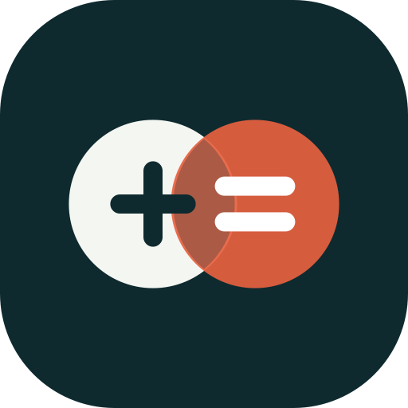

# MatchFund

[](https://opensource.org/license/mit/)



**Matching funds for Open Collective donations, counted by GenLayer validators from Open Collective's public records.
Only established donors count: no guest card-testing, no fresh accounts, and none of the sponsors the matcher's rules
exclude.**

A matching pledge ("every dollar you give this month, I give too") is one of the oldest ways to raise money for open
source. On Open Collective it has a problem: a large share of what a busy project "receives" is not what a matcher
means by a donation. In October 2026, webpack's Open Collective listed **361 contributions, $9,443**. Of those:

- **$4,089** came from 66 sponsors that the validators labelled as online casinos, sports betting or sellers of
  social-media followers,
- **$607** came in 204 contributions from accounts created that month, nearly all **$1 guest checkouts**, a pattern
  typical of card testing,
- and one donor gave **$2,500**, more than a matcher might want to match from a single donor.

A matcher who promised "1:1" would pay mostly for link-buying and card-testing. MatchFund puts the rules in a contract
and lets GenLayer validators count:

1. A **matcher** opens a match: a collective (its Open Collective slug), a **window** (up to 92 days, up to a year back
   or 92 days ahead), a **rate** (GEN per dollar given), a **pot** (the most it pays; taken from the matcher's deposit
   only after the validators agree), a **per-donor cap**, a **minimum donor-account age**, and **rules in plain words**
   for donors it will not match (for example *"no casino, betting or gambling sponsors, and no sellers of followers,
   likes, views or backlinks"*). Validators read the collective from Open Collective and freeze its name, type,
   currency and host.
2. **Two days after the window ends** (late card failures and refunds), **anyone counts it**. Every validator pages
   through every contribution Open Collective lists for the window (up to 2,000; a busier window is never counted
   partially) and checks, **in code**, that the sum without refunds equals **Open Collective's own total** for the
   window. Then, in code: refunds, the collective's own and its host's money, and money from accounts created less than
   the minimum age before the window opened are dropped, and each donor is capped.
3. The validators' model labels the **sponsors with a public profile** (website or description; up to 120, largest
   first) against the matcher's rules: COUNT, EXCLUDE or UNSURE. Unsure is not matched. A validator accepts the
   leader's count only if every number made in code is identical and its own labels move the matched total by at most
   5% (or $20).
4. For **10 minutes** after a count, **anyone may ask for a recount**, staking 10% of the pot. A different result
   replaces the count and returns the stake; the same result adds the stake to the collective's match. At most two.
5. Then anyone **finalizes**: the match (eligible dollars × rate, at most the pot) is credited to the **GenLayer wallet
   the collective publishes on its own Open Collective page** (a line such as `GenLayer wallet: 0x…`); until it
   publishes one, the match is **held** for it, and anyone can send it once the line appears (`claim`). After the
   holding period the matcher can take an unclaimed match back. What the match does not use goes back to the matcher at
   once. Every share is **credited**; GEN leaves the contract only through `withdraw()`, to the caller.

**Live app:** [matchfund-bars26.vercel.app](https://matchfund-bars26.vercel.app). Pick a collective and a month to see,
without a wallet, what Open Collective lists, how much comes from new accounts, and which sponsors the validators would
review against your rules. Opening a match needs MetaMask on GenLayer Studio (chain 61999) and **Test GEN** from the
header.

**Contract (GenLayer Studio):** [`0x5D68226feaca834Bff45629835009eE43e9CfEB1`](https://explorer-studio.genlayer.com/address/0x5D68226feaca834Bff45629835009eE43e9CfEB1)

## Why GenLayer

- **The count is not reported by anyone.** Every validator queries Open Collective itself, and the numbers made in code
  (contributions, refunds, new accounts, caps) must agree exactly. Nobody, matcher or collective, submits the figure
  money depends on.
- **The rules are written in words.** "No casino or follower-selling sponsors" is a judgement on a sponsor's name,
  website and description; validators make it and must agree on the money it moves, within a tolerance stated in the
  contract.
- **Every count can be checked.** The stored evidence packet keeps Open Collective's own total, every bucket, the
  excluded sponsors with the validators' reason, and sha256 hashes of the rows read.

## Verified live, on Open Collective's real records

`scripts/demo.mjs` ran MatchFund on GenLayer Studio with demo matches (test wallets, test GEN; not offers to these
collectives) on real Open Collective months. Every transaction, count, reconciliation and excluded sponsor is in
[`docs/REPRODUCTION.md`](docs/REPRODUCTION.md).

| Match | Collective, window | Open Collective lists (= its own total) | Not matched | Matched | Paid |
|---|---|---|---|---|---|
| `match_1` | webpack, October 2026; 0.001 GEN per $, pot 5 GEN, $1,000 cap per donor | 361 contributions, $9,443 | **$4,495** from 71 casino, betting and follower-selling sponsors; **$607** in 204 contributions from accounts created that month (guest checkouts); $1,500 over the cap; $200 unsure; $40 not reviewed | **$2,601** from 62 donors | **2.601 GEN**, plus a 0.5 GEN recount stake, held for webpack; 2.399 GEN back to the matcher |
| `match_2` | Babel, October 2026; 0.001 GEN per $, pot 1 GEN, no cap | 46 contributions, $6,831 | **$500** from Fun88 (sports betting) | **$6,331** from 45 donors | the whole **1 GEN** pot, held for Babel |
| `match_3` | Vue.js, December 2026 | | cancelled before the window started; pot credited back | | |

- **Refused, taking nothing:** a date that does not exist (2026-09-31), an account that is a person and not a collective,
  a slug Open Collective does not have, counting a cancelled match, a claim while webpack publishes no GenLayer wallet,
  and two withdrawals with nothing credited.
- **A recount** of `match_1` by a third wallet (0.5 GEN stake) came back the same, so the stake joined webpack's match.
- **Two independent counts of the same month** (`match_0`, the first live test right after deploying, and `match_1`):
  every number made in code was identical, and the validators' sponsor labels differed on 5 sponsors, moving the matched
  total by **$2** ($2,603 against $2,601). That is the variation the 5% tolerance is there for.
- `totals()` matched the contract's on-chain balance at **four points**, the last after every withdrawal.
- **A MetaMask test from the live app** (`match_4`, ESLint, October 2026): open, count (47 contributions, $4,085.86;
  $4,082.86 matched from 44 donors, $3 of new-account money not), recount (upheld), finalize and withdraw, every step
  ACCEPTED. Its seven transactions are in `docs/ui-test.json` and in REPRODUCTION.

## Who can do what (and the attacks this blocks)

| Rule | Why |
|---|---|
| The collective (name, type, currency, host) is frozen when the match opens | Nobody can later point the match at another account |
| Only collectives, funds, projects and events that are active can be matched | A person's account is not a collective |
| A window lasts at most 92 days and is counted from two days after it ends | Late refunds and card failures settle first |
| Every contribution is read, and the sum without refunds must equal Open Collective's own total; more than 2,000 is never counted | A count is never made from part of the record |
| Accounts created less than the minimum age before the window opened do not count | Guest card-testing, and fresh accounts made to farm a match |
| The collective's own and its host's money do not count | The collective cannot match its own transfers |
| A per-donor cap | One donor, or one sock puppet with an old account, cannot drain the pot |
| The model labels only sponsors with a public profile, against the matcher's own rules; UNSURE is not matched | The rules decide, and a doubtful sponsor costs the matcher nothing |
| Validators agree only if every count made in code is identical and the model's labels move the total by ≤5% (or $20) | Model variation is bounded and stated |
| Anyone can recount within 10 minutes for a 10% stake; same result sends the stake to the collective | Doubts are cheap to raise and costly to abuse |
| The match goes only to a wallet the collective publishes on its own Open Collective page; two different addresses count as none | Nobody can redirect a collective's match |
| An unclaimed match goes back to the matcher only after the holding period (30 to 400 days, chosen at opening) | The collective has time to publish a wallet |
| Pots and stakes come from a deposit and are taken only after consensus; payouts are credited; only `withdraw` sends GEN | No GEN rides on a reading, and no payout can fail halfway |
| `totals()` keeps running totals that must equal the contract's balance | Anyone can reconcile the books |

## Run it

```bash
python -m venv .venv && source .venv/bin/activate && pip install -r requirements.txt
genvm-lint check contracts/match_fund.py
python -m pytest tests/direct -q                         # 53 direct-mode tests
npm install
node scripts/deploy.mjs                                  # deploys to GenLayer Studio, prints the address
node scripts/demo.mjs <address>                          # the live demo; writes docs/demo-run.json
node scripts/reproduction.mjs                            # renders docs/REPRODUCTION.md
node scripts/verify-code.mjs <address>                   # checks the deployed code is byte-identical
cd frontend && npm run dev                               # the app on localhost:3000
```

## Limits

- Open Collective's public API is rate-limited without a key. A count makes one or two requests per validator; when
  Open Collective refuses, nothing is decided and the call can be sent again.
- The model sees what a sponsor publishes about itself. A gambling sponsor with an empty profile is not reviewed (it
  counts like a plain donor, within the per-donor cap); one with a misleading profile can pass. UNSURE and the per-donor
  cap limit what that costs.
- A count is a snapshot: a refund recorded after it is not seen unless someone asks for a recount in time.
- Collectives do not publish GenLayer wallets yet, so matches are held for them; the demo shows the held state, and
  the claim path is covered by the tests.
- GenLayer Studio only. The source carries the Bradbury testnet header switch used by our other projects.
